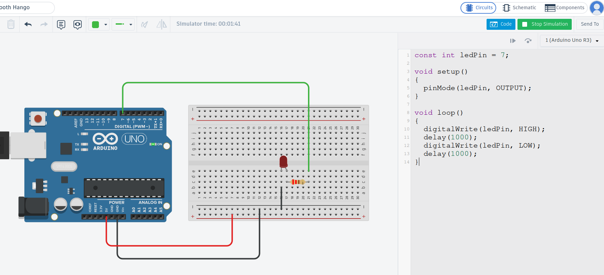
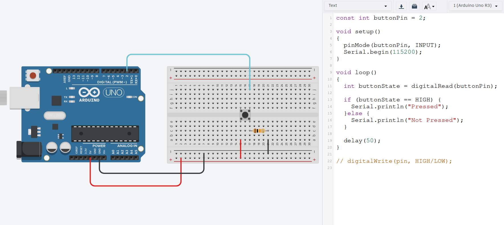
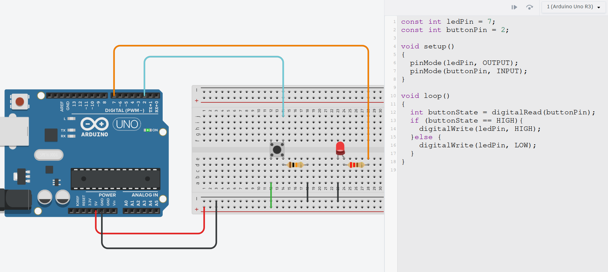
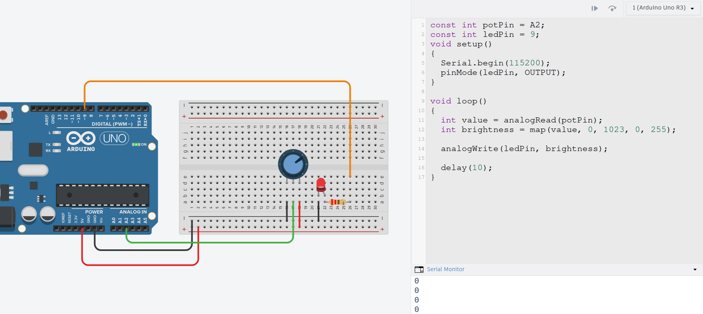

# 1·2일차 (261114 ~ 261115) 로봇 구동 시스템과 임베디드 기초

1일차에는 로봇 구동 시스템의 구조(고수준/저수준), 리눅스, 임베디드 시스템과 전기 기초, GPIO, ADC를 배우고 틴커캐드(Tinkercad)에서 LED 점멸 실습을 진행했다.
2일차에는 GPIO 레지스터, 풀다운/풀업, 시리얼 통신, PWM, 서보모터를 배우고 틴커캐드(Arduino Uno)와 수업용 PCB의 ESP32로 버튼, 가변저항, 서보모터, 부저 실습을 진행했다.

---

## 1. 파일 구조

```
Robotics-202136021/
├── 261114/                              # 1일차
│   ├── 261114_LED.txt                   # [Tinkercad] LED 점멸 코드
│   └── 261114_LED.png                   # 회로 및 코드 캡처
└── 261115/                              # 2일차
    ├── README.md                        # 1·2일차 정리 문서 (이 파일)
    ├── 261115_BUTTON.txt                # [Tinkercad] 버튼 입력을 시리얼로 출력
    ├── 261115_BUTTON.png
    ├── 261115_BUTTON_LED.txt            # [Tinkercad] 버튼으로 LED 제어
    ├── 261115_BUTTON_LED.png
    ├── 261115_POTENTIOMETER.txt         # [Tinkercad] 가변저항으로 LED 밝기 제어
    ├── 261115_POTENTIOMETER.png
    ├── test_potentiometer.ino           # [ESP32] 가변저항 값을 시리얼로 출력
    ├── test_servo.ino                   # [ESP32] 서보모터 0~180도 왕복
    ├── test_servo_potentiometer.ino     # [ESP32] 가변저항으로 서보 각도 제어
    └── test_buzzer.ino                  # [ESP32] 부저로 주파수별 소리 출력
```

- `.txt` 파일은 틴커캐드 코드 편집기에서 작성한 코드 
- `.png` 파일은 같은 실습의 회로와 코드를 캡처
- `.ino` 파일은 실제 ESP32 보드에 업로드한 Arduino 스케치

---

## 2. 개발 환경 및 의존성

| 구분 | 내용 |
| --- | --- |
| 시뮬레이션 | Tinkercad Circuits (웹 브라우저, Autodesk 계정 필요), 보드: Arduino Uno R3 |
| 운영체제 | Ubuntu (ESP32 실습) |
| IDE | Arduino IDE 2.3.10 (Linux AppImage) |
| 보드 패키지 | esp32 by Espressif Systems (Arduino IDE Boards Manager) |
| 라이브러리 | ESP32Servo (서보 실습에 필요, Arduino IDE Library Manager) |
| 하드웨어 | 수업용 자율주행 로봇 PCB (ESP32와 가변저항, 서보모터, 부저가 연결된 보드), USB 케이블 |
| 틴커캐드 부품 | LED, 저항, 푸시버튼, 가변저항, 브레드보드, 점퍼선 (시뮬레이션 내 가상 부품) |

---

## 3. 실행 방법

### 3.1 저장소 받기

```bash
git clone https://github.com/SungYeopLim/Robotics-202136021.git
cd Robotics-202136021
```

### 3.2 틴커캐드 실습 (`261114_LED`, `261115_BUTTON`, `261115_BUTTON_LED`, `261115_POTENTIOMETER`)

1. https://www.tinkercad.com 에 로그인한 뒤 Circuits → 새 회로 만들기를 선택한다.
2. 실습별 `.png` 이미지를 보고 Arduino Uno R3, 브레드보드, 부품을 같은 위치에 배치한다.
3. 오른쪽 위 `코드` → 편집 방식을 `텍스트`로 바꾸고, 같은 이름의 `.txt` 파일 내용을 붙여 넣는다.
4. `시뮬레이션 시작`을 누른다. 시리얼 출력이 있는 실습은 코드 창 아래 `직렬 모니터`에서 확인한다.

### 3.3 ESP32 실습 (`test_*.ino`)

**(1) 시리얼 포트 권한 설정**

리눅스에서 USB로 연결한 ESP32는 `/dev/ttyUSB0` 같은 시리얼 장치로 잡히며, 이 장치는 `dialout` 그룹만 접근할 수 있다. 사용자를 `dialout` 그룹에 추가하지 않으면 업로드할 때 포트 권한 오류가 발생한다.

```bash
sudo usermod -a -G dialout $USER
reboot
```

재부팅 후 아래 명령으로 `dialout`이 포함되어 있는지, ESP32 포트가 보이는지 확인한다.

```bash
groups
ls -l /dev/ttyUSB*
```

**(2) Arduino IDE 설치**

Arduino IDE 2.3.10 Linux용 AppImage를 내려받아 실행 권한을 주고 실행한다. AppImage 실행에는 `libfuse2t64` 패키지가 필요하다.

```bash
sudo apt update
sudo apt install -y libfuse2t64
chmod +x arduino-ide_2.3.10_Linux_64bit.AppImage
./arduino-ide_2.3.10_Linux_64bit.AppImage --no-sandbox
```

**(3) ESP32 보드 패키지와 라이브러리 설치**

1. `File → Preferences → Additional boards manager URLs`에 아래 주소를 추가한다.
   ```
   https://espressif.github.io/arduino-esp32/package_esp32_index.json
   ```
2. `Boards Manager`에서 `esp32 by Espressif Systems`를 설치한다.
3. `Library Manager`에서 `ESP32Servo`를 설치한다.

**(4) 업로드 및 실행**

1. PCB의 ESP32를 USB로 연결하고 `Tools → Board`에서 `ESP32 Dev Module`, `Tools → Port`에서 `/dev/ttyUSB0`을 선택한다.
2. `261115/` 폴더의 `.ino` 파일을 연다. Arduino IDE는 스케치 파일이 같은 이름의 폴더 안에 있어야 하므로, 폴더를 만들어 옮길지 묻는 창이 뜨면 확인을 누른다.
3. `Upload` 버튼을 누른다.
4. 시리얼 출력이 있는 코드(`test_potentiometer.ino`, `test_servo_potentiometer.ino`)는 `Serial Monitor`를 열고 통신 속도를 `115200 baud`로 맞춘다.

가변저항, 서보모터, 부저는 수업용 PCB에 이미 연결되어 있으므로 별도 배선은 필요 없다. 코드에서 사용하는 PCB의 GPIO 구성은 다음과 같다.

| 부품 | ESP32 GPIO | 사용 파일 |
| --- | --- | --- |
| 가변저항 | 39 | `test_potentiometer.ino`, `test_servo_potentiometer.ino` |
| 서보모터 | 14 | `test_servo.ino`, `test_servo_potentiometer.ino` |
| 부저 | 5 | `test_buzzer.ino` |

---

## 4. 이론적 배경

### 4.1 1일차 (261114)

#### 4.1.1 로봇 자율주행 과정 구성

이번 과정은 고수준 판단이 실제로 저수준 모터(하드웨어) 제어로 어떻게 이어지는지를 다룬다.

1. 임베디드 시스템 기반 저수준 제어
2. ROS2 기초 및 고수준 판단
3. SLAM & Navigation
4. RTOS 기반 고수준-저수준 연동

시뮬레이션에서 자율주행을 완성하는 것이 1차 목표이고, 실제 하드웨어까지 연결하는 것은 그 다음 단계이다.

#### 4.1.2 로봇 구동 시스템: 고수준과 저수준

로봇 주행은 단순한 모터 제어가 아니라 센서 데이터 처리, 위치 추정, 경로 계획, 모터 제어가 동시에 수행되는 작업이다. 각 기능은 요구되는 연산량과 제어 주기가 다르기 때문에 로봇 시스템은 일반적으로 고수준(High-level)과 저수준(Low-level)으로 역할을 나눈다.

- **High-level**: SBC / ROS2 → Perception, Planning, Navigation
- **Low-level**: MCU / RTOS → Motor, Encoder, Control
- High-level + Low-level = Robot Drive System

**고수준 (Decision-Making)**

- 센서 데이터 처리 및 주변 환경 인식
- Localization / Mapping / SLAM
- Path Planning 및 Navigation
- 카메라, LiDAR 등 대용량 센서 데이터 처리
- ROS2 기반의 여러 노드 실행
- 높은 연산 성능과 메모리가 필요하다.
- 하드웨어: SBC(Single Board Computer) — Jetson, Raspberry Pi 등

**저수준 (Control)**

- 모터 PWM 출력
- Encoder 데이터 처리
- PID Control
- 각종 센서 데이터 수집 및 전처리 (IMU, Ultrasonic 등)
- GPIO, ADC/DAC, UART, I2C, SPI 등 하드웨어 직접 제어
- 짧고 **일정한 주기**의 제어 수행
- 하드웨어: MCU(Micro Controller Unit) — Arduino, OpenCR, ESP32 등
  - MCU는 저수준의 연산을 담당하는 장치로, 로봇에서 근육을 움직이는 뇌와 같은 역할을 한다. 전압을 읽고(입력) 만들어 내는(출력) 장치이며, 사용할 수 있는 메모리가 매우 제한적이다.
  - OpenCR은 연산 성능이 좋은 로봇용 제어 보드이고, ESP32는 Wi-Fi와 Bluetooth 무선 통신을 지원한다. 이 과정에서는 ESP32를 사용한다.

**역할을 분리하는 이유**

- 고수준은 많은 연산량이 필요하고, 저수준은 빠르고 일정한 제어 주기가 필요하다.
- SBC는 리눅스 기반으로 다양한 소프트웨어와 고성능 연산 환경을 제공하지만, 여러 프로세스가 동시에 실행되기 때문에 제어 주기가 일정하지 않을 수 있다.
- MCU + RTOS는 모터 제어처럼 주기적인 작업을 안정적으로 수행할 수 있다.
- 역할을 나누면 각 하드웨어의 장점을 모두 활용할 수 있다.

컴퓨터에서는 같은 프로그램도 실행할 때마다 처리 시간이 조금씩 다르지만, 로봇의 모터 제어가 지연되면 바로 사고로 이어질 수 있다. 즉 **명령(판단)은 조금 늦어도 되지만 제어는 늦으면 안 된다.**

|  | 고수준 | 저수준 |
| --- | --- | --- |
| 역할 | 판단 / 계획 | 직접 제어 |
| 연산량 | 높음 | 상대적으로 낮음 |
| 중요 요소 | 처리 성능 | 실시간성 |
| 하드웨어 | SBC | MCU |
| OS | Linux | RTOS |
| 소프트웨어 | ROS2 | Firmware / micro-ROS |
| 개발 언어 | Python / C++ | C / C++ |

ROS2는 Python으로 노드를 작성할 수 있지만 실제로는 설정 파일, 빌드 파일 등 여러 종류의 파일을 함께 다룬다. 저수준은 실행 속도가 중요하기 때문에 C/C++를 사용한다.

#### 4.1.3 리눅스와 CLI

**리눅스를 사용하는 이유**

- 높은 개발 자유도: 오픈소스 기반으로 시스템 내부 구조와 커널 수준까지 수정할 수 있다.
- 강력한 패키지 관리: `apt` 등으로 소프트웨어 설치, 의존성 관리, 업데이트가 쉽다.
- ROS2 중심의 개발 생태계: 주요 로봇 소프트웨어, 라이브러리, 개발 문서가 Ubuntu 환경을 중심으로 제공된다.
- 광범위한 활용 분야: 서버, 클라우드, 임베디드 시스템 등 IT 인프라 전반에서 쓰인다.

**CLI (Command Line Interface)**

사용자가 명령어를 입력해 컴퓨터와 상호작용하는 방식이다. GUI(아이콘, 창, 마우스로 조작)로는 할 수 없는 작업이 많기 때문에 CLI에 익숙해지는 것이 중요하다.

```
user_name@host_name:~$
```

- `user_name@host_name`: `@`로 사용자와 컴퓨터를 구분한다.
- `~`: 사용자의 홈 디렉토리 (`~` = `$HOME` = `/home/<사용자명>`)
- `/`: 폴더와 폴더를 구분한다. `/`로 시작하는 경로는 루트부터 시작하는 **절대 경로**, `/`로 시작하지 않는 경로는 현재 위치 기준의 **상대 경로**이다.

| 명령 / 표현 | 의미 |
| --- | --- |
| `pwd` | print working directory, 현재 위치의 절대 경로 출력 |
| `rm -r <폴더>` | 폴더와 그 안의 모든 하위 파일을 재귀적으로 삭제 |
| `#!/usr/bin/python3` | 셰뱅(shebang). 스크립트 첫 줄에 적어 어떤 인터프리터로 실행할지 지정 |
| `$변수명` | 환경 변수 값을 참조 (예: `echo $HOME`) |
| `echo "source ~/.venv/bin/activate" >> ~/.bashrc` | `.bashrc`는 터미널을 열 때마다 실행되므로, 여기에 추가하면 터미널을 열 때마다 가상환경이 활성화된다 |

#### 4.1.4 임베디드 시스템과 ESP32

**임베디드 시스템**

- 큰 시스템 안에서 특정 기능을 수행하도록 설계된 시스템이다. (예: 자동차 안의 주차 보조 시스템)
- MCU 기반으로 동작한다.
- 센서와 액추에이터에 직접 연결되어 물리적 환경과 상호작용한다.
- 자동차 제어 시스템, 산업용 로봇, IoT 디바이스, 의료기기 등에 활용된다.
- 연산량과 컴퓨팅 자원(CPU, 메모리)은 제한적이지만 실시간 처리와 제어에 적합하다.
- 하드웨어와 소프트웨어를 함께 다룰 수 있어야 한다.

**ESP32**

- Wi-Fi, Bluetooth를 지원하는 MCU이다.
- 칩(SoC): CPU, 메모리, 주변장치를 하나로 통합한 반도체
- 모듈: 칩에 Flash 메모리, 무선 통신 관련 부품 등을 더한 것
- 개발 보드: 모듈에 전원 회로, USB 통신 회로, 핀 헤더 등을 추가해 바로 개발할 수 있게 만든 보드

**임베디드 기초 용어**

| 분류 | 용어 |
| --- | --- |
| 전기적 기초 | Voltage, Current, VCC, GND |
| 신호의 종류 | Analog, Digital |
| 디지털 신호 해석 | HIGH/LOW, Logic Level (3.3V / 5V) |
| MCU 입출력 | GPIO, Input/Output |
| 디지털 출력 응용 | PWM, Duty Cycle, Frequency |
| 아날로그 입출력 | ADC, DAC |
| 외부 장치 통신 | UART, I2C, SPI |

#### 4.1.5 전압, 전류, 저항과 GND

폭포에 비유하면 다음과 같다.

- **전압(V)**: 폭포수를 맞는 사람이 받는 힘. 전압은 전기 자체가 아니라 위치 에너지와 같은 개념이다.
- **전류(I)**: 폭포가 흐르는 힘 자체
- **저항(R)**: 폭포 중간에 튀어나온 돌
- 세 값은 옴의 법칙 **V = I × R** 의 관계를 가진다.

전압은 항상 기준점과 비교한 값이다. 절벽에서 끝없이 떨어지기만 하면 아프지 않은 것처럼, 부딪힐 땅이 있어야 전압이 생긴다. 이 기준점이 **GND(Ground, 0V)** 이고, 전압을 공급하는 쪽이 **VCC(+)** 이다. 전류는 VCC에서 GND로 흐른다.

**Common GND**: 같은 구름에서 물을 뿌려도 바닥의 깊이가 다르면 떨어지는 높이가 달라진다. 마찬가지로 센서와 컨트롤러의 GND가 서로 다르면 같은 신호도 다른 전압으로 해석된다. 센서와 컨트롤러가 신호로 대화하려면 GND를 하나로 연결해 기준을 통일해야 한다.

#### 4.1.6 GPIO

**GPIO (General Purpose Input Output)** 는 용도를 프로그램으로 정할 수 있는 범용 입출력 핀이다. 핀은 전기로 외부와 소통하는 창구이며, 핀이 하는 일은 결국 전압을 읽거나 내보내는 것이다.

- 입력(Input) 핀: 전압을 읽어 센서 값이나 버튼 상태를 확인한다. (`digitalRead`)
- 출력(Output) 핀: LED, 모터 등에 전압을 내보낸다. (`digitalWrite`)
- VCC, GND 핀은 전원 공급용이므로 범용 핀이 아니다.

#### 4.1.7 디지털과 아날로그, HIGH/LOW

- **디지털**: 0 또는 1 두 가지 상태만 가지는 신호
- **아날로그**: 소리 크기나 전압처럼 연속적으로 변하는 신호
- **HIGH / LOW**: 디지털 신호를 ON/OFF 전압으로 표현한 것. HIGH는 VCC 수준(5V 또는 3.3V), LOW는 0V이다.
- **로직 레벨(Logic Level)**: 논리 회로가 동작하는 기준 전압이다. Arduino Uno는 5V, ESP32는 **3.3V**를 사용한다.
  - ESP32의 GPIO에 3.3V보다 높은 전압을 직접 넣으면 칩이 손상될 수 있다.
  - 보드의 `3V3` 핀은 3.3V 출력, `5V` 핀은 5V를 외부 부품에 공급하는 핀이다.

#### 4.1.8 ADC와 DAC

- **ADC (Analog to Digital Converter)**: 아날로그 전압을 정수 값으로 변환한다. 센서가 물리량(소리, 회전 등)을 전압으로 바꾸면, ADC가 그 전압을 MCU가 다룰 수 있는 숫자로 바꾼다.
- **DAC (Digital to Analog Converter)**: 숫자 값을 아날로그 전압으로 변환한다.

ADC는 연속적인 전압을 계단 형태의 이산적인 값으로 나눠 표현한다. 몇 단계로 나눌지는 **해상도(bit 수)** 로 정해지며, 해상도는 MCU마다 하드웨어적으로 정해져 있다.

| 해상도 | 값 범위 | 예 |
| --- | --- | --- |
| 8bit | 0 ~ 255 | 1byte |
| 10bit | 0 ~ 1023 | Arduino Uno의 `analogRead` |
| 12bit | 0 ~ 4095 | ESP32의 `analogRead` |

예를 들어 Arduino Uno는 0~5V를 1024단계로 나누므로 한 단계는 약 4.9mV이다.

#### 4.1.9 펌웨어 기본 구조

- `setup()`: 전원이 들어오거나 리셋될 때 한 번 실행된다. 핀 모드 설정, 시리얼 시작 등 초기화를 담당한다.
- `loop()`: `setup()` 이후 계속 반복 실행된다.

### 4.2 2일차 (261115)

#### 4.2.1 ESP32 보드의 핀 구성

- `3V3`, `5V`: 전압이 나가는 핀
- 디지털 핀: 보드를 Arduino와 같은 모양으로 만들기 위해 배치했기 때문에 핀 번호가 순서대로 되어 있지 않다.
- 아날로그 핀: ADC에 사용하는 핀

#### 4.2.2 GPIO와 레지스터

MCU 내부에는 **레지스터**라는 아주 작은 메모리가 있고, 핀마다 1bit씩 공간이 할당되어 있다. Arduino 함수는 이 레지스터의 비트를 바꾸거나 읽는 동작을 감싼 것이다.

| 레지스터 | 관련 함수 | 설명 |
| --- | --- | --- |
| DDR (Data Direction Register) | `pinMode()` | 핀을 입력으로 쓸지 출력으로 쓸지 1bit로 저장 |
| 출력 레지스터 | `digitalWrite()` | 해당 비트를 1/0으로 바꿔 핀에 HIGH/LOW 출력 |
| 입력 레지스터 | `digitalRead()` | 핀의 전압 상태가 1/0으로 기록되고 이를 읽음 |

레지스터에 직접 접근해 비트 연산으로 제어하는 것이 더 저수준의 방식이다.

#### 4.2.3 풀다운과 풀업

전압은 압력일 뿐이고, 부품을 손상시키는 것은 과도한 전류이다. 그래서 LED처럼 전류가 쉽게 많이 흐르는 부품에는 저항을 직렬로 연결해 전류를 제한한다.

푸시버튼은 전자 부품이 아니라 누르면 연결되고 떼면 끊어지는 단순한 전선이다. 내부는 H 모양으로 되어 있어 누르면 양쪽이 연결된다.

버튼을 VCC와 입력 핀 사이에만 연결하면, 눌렀을 때는 HIGH가 되지만 떼었을 때는 핀이 어디에도 연결되지 않은 상태가 된다. 이 상태를 **플로팅(Floating)** 이라고 하며, 주변 잡음 때문에 값이 HIGH와 LOW 사이를 무작위로 오가서 버튼 상태를 제대로 감지할 수 없다.

- **풀다운(Pull-down)**: 입력 핀을 저항을 통해 GND에 연결한다. 기본 상태는 LOW이고, 버튼을 누르면 HIGH가 된다.
- **풀업(Pull-up)**: 입력 핀을 저항을 통해 VCC에 연결한다. 기본 상태는 HIGH이고, 버튼을 누르면 LOW가 된다.

저항은 버튼을 눌렀을 때 VCC와 GND가 바로 연결(단락)되는 것을 막는다. 옴의 법칙으로 흐르는 전류를 계산할 수 있다. (예: 5V, 10kΩ이면 I = 5 / 10000 = 0.5mA)

#### 4.2.4 시리얼 통신

MCU가 컴퓨터 화면에 글자를 출력하려면 문자를 하나씩 비트 단위로 보내야 한다. 이때 사용하는 것이 시리얼 통신이다.

- **직렬(Serial)**: 선 하나로 데이터를 한 비트씩 차례대로 보낸다. `abc`를 보내면 a, b, c가 순서대로 전달된다.
- **병렬(Parallel)**: 여러 개의 선으로 여러 비트를 동시에 보낸다.
- USB(Universal Serial Bus)도 직렬 통신 방식이다.

`Serial.begin(115200);`은 시리얼 통신을 시작하는 명령이고, 115200은 **baud rate**(1초에 보내는 비트 수, bit/s)이다. 보내는 쪽과 받는 쪽의 baud rate가 다르면 문자가 깨져서 출력된다. 주로 9600, 115200을 사용한다.

#### 4.2.5 PWM과 듀티 사이클

디지털 핀은 HIGH와 LOW만 출력할 수 있다. 하지만 아주 짧은 시간 동안 켜고 끄기를 반복하면 평균 전압을 조절하는 것과 같은 효과를 얻을 수 있다. 이 방식이 **PWM (Pulse Width Modulation)** 이다.

- **듀티 사이클(Duty Cycle)**: 한 주기 중 HIGH인 시간의 비율. 50%이면 절반은 켜지고 절반은 꺼져 LED가 약 50% 밝기로 보인다.
- **주파수(Frequency)**: 1초에 켜고 끄기를 반복하는 횟수. MCU 내부 타이머(클럭)를 이용해 주기를 만든다.
- 평균 전압 ≈ VCC × 듀티 사이클

Arduino Uno에서는 `~` 표시가 있는 핀만 PWM을 출력할 수 있고, `analogWrite(pin, 0~255)`로 8bit 듀티 값을 지정한다.

ADC 값(10bit, 0~1023)으로 PWM(8bit, 0~255)을 제어하려면 범위를 바꿔야 한다. 이때 `map()`을 사용한다.

```cpp
int brightness = map(value, 0, 1023, 0, 255);   // 10bit 값을 8bit 범위로 비례 변환
```

#### 4.2.6 IMU

로봇의 자세와 움직임을 측정하는 센서이다.

- 자이로스코프: 회전 속도(각속도) 측정
- 가속도계: 선형 가속도 측정
- 지자기 센서(Magnetometer): 나침반처럼 방향을 측정하지만, 주변 자석의 영향을 크게 받아 이 과정에서는 사용하지 않는다.

#### 4.2.7 서보모터

- 0~180도 범위에서 지정한 각도로 회전하는 모터이다.
- 일반 모터는 자신이 몇 도에 있는지 알 수 없지만, 서보모터는 내부에서 현재 각도를 측정해 목표 각도에 맞춘다.
- 전원과 제어 신호가 계속 공급되는 동안 지정한 각도를 유지한다. 로봇 팔이 특정 자세로 고정되는 원리이다.
- 제어 신호는 PWM이며, 듀티 사이클로 각도를 지정한다. 보통 50Hz(주기 20ms) 신호에서 HIGH 펄스 폭(약 0.5~2.5ms)이 0~180도에 대응한다.
- 중간 각도(예: 90도)에서는 눈에 잘 보이지 않는 미세한 떨림이 생길 수 있으며, 입력 값을 각도 범위에 맞게 매핑해야 한다.
- 배선: 갈색 GND, 빨간색 전원, 노란색 신호
- ESP32에서는 `ESP32Servo` 라이브러리로 서보를 제어한다.

#### 4.2.8 Flash와 업로드

업로드는 작성한 코드를 컴파일해 ESP32 내부의 **Flash 메모리**에 기록하는 것이다. Flash는 전원이 꺼져도 내용이 유지되므로, 다시 전원을 넣으면 업로드한 코드가 실행된다.

---

## 5. 실습 내용 및 결과 분석

모든 실습은 의도한 대로 동작하는 것을 확인했다.

### 5.1 [1일차 / Tinkercad] LED 점멸 — `../261114/261114_LED.txt`



- **사용 이론**: GPIO 출력, HIGH/LOW, 전류 제한 저항, `setup()`/`loop()` 구조
- **회로**: 7번 핀 → 저항 → LED(+) → LED(-) → GND
- **동작**: `pinMode(ledPin, OUTPUT)`으로 7번 핀을 출력으로 설정하고, `loop()`에서 1초마다 HIGH/LOW를 바꿔 LED를 깜빡인다.
- **결과 분석**
  - LED가 1초 간격으로 켜지고 꺼지는 것을 확인했다.
  - `delay()`가 실행되는 동안 MCU는 다른 작업을 하지 못한다. 다른 작업을 함께 하려면 `delay()` 대신 경과 시간을 비교하는 방식이 필요하다.

### 5.2 [2일차 / Tinkercad] 버튼 입력 — `261115_BUTTON.txt`



- **사용 이론**: GPIO 입력, 풀다운, 플로팅, 시리얼 통신(115200 baud)
- **회로**: 5V → 버튼 → 2번 핀, 2번 핀 → 저항 → GND (풀다운)
- **동작**: 50ms마다 `digitalRead`로 버튼 상태를 읽어 `Pressed` / `Not Pressed`를 시리얼 모니터에 출력한다.
- **결과 분석**
  - 풀다운 저항 덕분에 버튼을 누르지 않을 때는 LOW로 읽혀 `Not Pressed`가 출력되고, 누르면 `Pressed`가 출력됐다.
  - 상태가 바뀌지 않아도 50ms마다 계속 출력하므로 시리얼 모니터가 같은 문자열로 채워진다. 이전 상태를 저장해 두고 상태가 바뀔 때만 출력하면 더 보기 좋다.

### 5.3 [2일차 / Tinkercad] 버튼으로 LED 제어 — `261115_BUTTON_LED.txt`



- **사용 이론**: GPIO 입력과 출력, 풀다운
- **회로**: 5.2의 버튼 회로 + 7번 핀 → 저항 → LED → GND
- **동작**: 버튼이 눌리면(HIGH) LED를 켜고, 아니면 끈다.
- **결과 분석**
  - 버튼을 누르는 동안에만 LED가 켜지는 것을 확인했다.
  - 입력 핀의 상태를 그대로 출력 핀에 전달하는 구조로, 입력 → 판단 → 출력으로 이어지는 제어의 가장 단순한 형태이다.

### 5.4 [2일차 / Tinkercad] 가변저항으로 LED 밝기 제어 — `261115_POTENTIOMETER.txt`



- **사용 이론**: ADC(10bit), `map()`, PWM, 듀티 사이클
- **회로**: 가변저항 양 끝 → 5V, GND / 가운데 → A2, 9번(`~`) 핀 → 저항 → LED → GND
- **동작**: `analogRead(A2)`로 0~1023 값을 읽고, `map()`으로 0~255로 바꿔 `analogWrite`로 LED 밝기를 조절한다.
- **결과 분석**
  - 가변저항을 돌리는 정도에 따라 LED 밝기가 바뀌는 것을 확인했다.
  - LED를 PWM이 가능한 `~` 핀(9번)에 연결해야 밝기 조절이 된다.
  - 코드에서 `Serial.begin(115200)`을 호출하지만 출력하는 부분은 없다. `Serial.println(value)`를 추가하면 ADC 값과 밝기의 관계를 숫자로 함께 확인할 수 있다.

### 5.5 [2일차 / ESP32] 가변저항 값 읽기 — `test_potentiometer.ino`

- **사용 이론**: ADC(12bit), 시리얼 통신
- **회로**: PCB의 가변저항 → GPIO 39
- **동작**: 10ms마다 `analogRead`로 값을 읽어 시리얼 모니터에 출력한다.
- **결과 분석**
  - 가변저항을 돌리는 만큼 시리얼 모니터의 값이 바뀌는 것을 확인했다.
  - 틴커캐드의 Arduino Uno(0~1023)와 달리 ESP32의 ADC는 12bit이므로 값의 범위가 0~4095이다.

### 5.6 [2일차 / ESP32] 서보모터 0~180도 왕복 — `test_servo.ino`

- **사용 이론**: 서보모터, PWM
- **회로**: PCB의 서보모터 → GPIO 14
- **동작**: `myServo.write(degree)`로 각도를 1도씩 0 → 180 → 0으로 바꾸며 왕복한다.
- **결과 분석**
  - 서보가 0도와 180도 사이를 반복해서 왕복하는 것을 확인했다.
  - 1도마다 `delay(1)`이므로 각도 명령이 매우 빠르게 바뀐다. 1도당 `delay`를 늘리면 서보가 더 천천히 움직인다.

### 5.7 [2일차 / ESP32] 가변저항으로 서보 각도 제어 — `test_servo_potentiometer.ino`

- **사용 이론**: ADC(12bit), 비례 변환, 서보모터
- **회로**: PCB의 가변저항(GPIO 39)과 서보모터(GPIO 14)
- **동작**: 가변저항 값(0~4095)을 `value / 4096 * 180`으로 0~180도로 바꿔 서보 각도를 지정한다. 100ms마다 갱신한다.
- **결과 분석**
  - 가변저항을 돌리는 만큼 서보가 따라 회전하는 것을 확인했다.
  - ADC 최대값은 4095이므로 `4095 / 4096 * 180 = 179.95…`가 되고, `int`로 바꾸면 179도가 최대이다. `4095`로 나누거나 `map(value, 0, 4095, 0, 180)`을 사용하면 180도까지 사용할 수 있다.
  - 100ms마다 갱신하므로 가변저항을 빠르게 돌리면 서보가 약간 늦게 따라온다. 갱신 주기를 줄이면 더 빠르게 반응한다.

### 5.8 [2일차 / ESP32] 부저 — `test_buzzer.ino`

- **사용 이론**: PWM, 주파수
- **회로**: PCB의 부저 → GPIO 5
- **동작**: `tone()`으로 지정한 주파수의 신호를 부저에 출력한다. 64Hz → 128Hz → 256Hz 순서로 소리를 내고, 0을 주어 소리를 끈다. 이 과정을 반복한다.
- **결과 분석**
  - 주파수가 커질수록 높은 소리가 나는 것을 확인했다.
  - 실습 당시 작성한 원본 코드가 남아 있지 않아, 실습 내용(64, 128, 256, 0 순서로 출력)을 바탕으로 다시 작성했다. 각 소리 사이의 `delay`는 1초로 설정했다.
