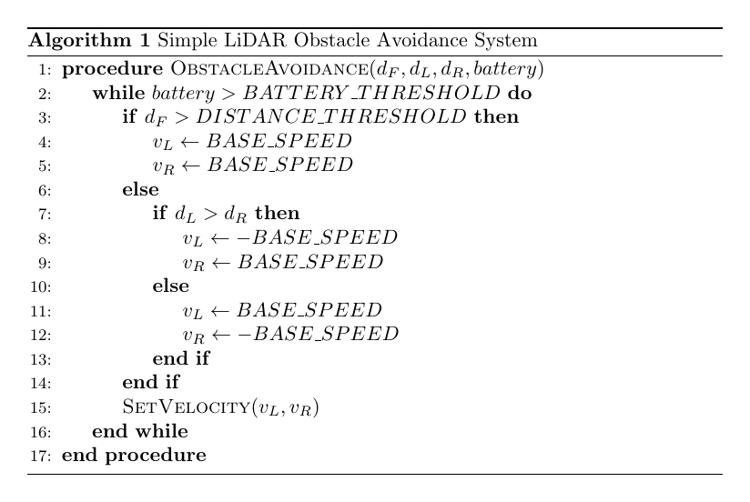
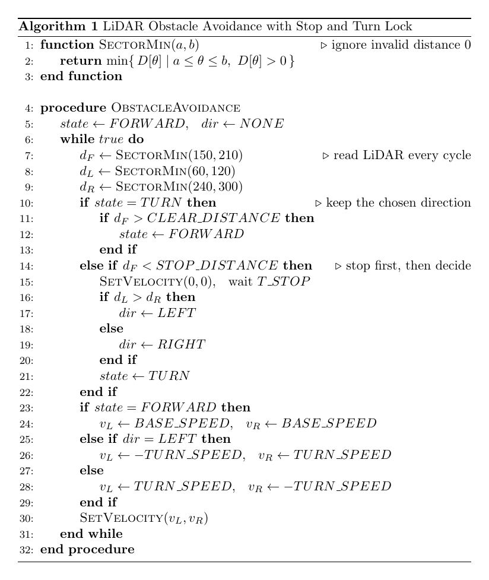

# Project01 LiDAR 장애물 회피 주행

수업용 자율주행 로봇(ESP32)에 장착된 LiDAR로 주변 거리를 측정하고, 앞에 장애물이 있으면 멈춘 뒤 더 넓은 쪽으로 회전해 피하는 자율주행 코드를 작성했다.
강사 제공 예제 알고리즘(`sample_code/Latex/algorithm_template.tex`)의 "앞이 막히면 더 넓은 쪽으로 돈다"는 구조를 유지하고, 실제 로봇에서 생기는 문제 네 가지를 고쳐 알고리즘을 완성했다.

---

## 1. 파일 구조

```
Project01/
├── README.md                          # 프로젝트 정리 문서 (이 파일)
├── obstacle_avoidance/
│   └── obstacle_avoidance.ino         # [ESP32] LiDAR 장애물 회피 주행 코드
└── algorithm/
    ├── algorithm_template.tex         # 강사 제공 예제 알고리즘 (원본)
    ├── algorithm_template.png         # 예제 알고리즘 렌더링 이미지
    ├── algorithm.tex                  # 수정한 알고리즘
    └── algorithm.png                  # 수정한 알고리즘 렌더링 이미지
```

- `.ino` 파일은 Arduino IDE 규칙에 따라 파일 이름과 같은 이름의 폴더 안에 두었다.
- `.tex` 파일은 Overleaf에서 렌더링해 `.png`로 저장했다.

---

## 2. 개발 환경 및 의존성

| 구분 | 내용 |
| --- | --- |
| 운영체제 | Ubuntu 24.04 |
| IDE | Arduino IDE 2.3.10 (Linux AppImage) |
| 보드 패키지 | esp32 by Espressif Systems 3.x (`ledcAttach`, `ledcWrite` 사용) |
| 보드 설정 | ESP32 Dev Module, `/dev/ttyUSB0` |
| 하드웨어 | 수업용 자율주행 로봇 (ESP32 PCB, DC 모터 4개, LiDAR, 배터리) |
| 알고리즘 작성 | Overleaf (LaTeX, `algorithm`, `algpseudocode` 패키지) |

---

## 3. 실행 방법

### 3.1 업로드

1. 로봇의 ESP32를 USB로 연결하고 Arduino IDE에서 `obstacle_avoidance/obstacle_avoidance.ino`를 연다.
2. `Tools → Board`에서 `ESP32 Dev Module`, `Tools → Port`에서 `/dev/ttyUSB0`을 선택하고 업로드한다.
3. 업로드가 `Connecting......`에서 멈추면 보드의 BOOT 버튼을 누른 채로 다시 시도한다.

### 3.2 동작 확인 (바퀴를 띄운 상태)

1. 로봇을 상자 위에 올려 바퀴가 바닥에 닿지 않게 하고, 배터리 전원 버튼을 켠다.
2. 시리얼 모니터를 115200 baud로 열면 0.2초마다 다음 형식의 로그가 출력된다.

   ```
   <시간> ms | dF: <앞 거리> dL: <왼쪽 거리> dR: <오른쪽 거리> | <상태> | vL: <왼쪽 속도> vR: <오른쪽 속도>
   ```

3. 로봇 앞을 손으로 막으면 `FORWARD → STOP → TURN_LEFT/TURN_RIGHT`로 바뀌고, 손을 치우면 `FORWARD`로 돌아오는지 확인한다.
4. 직진할 때 바퀴 4개가 모두 로봇 기준 앞으로 도는지 확인한다. 반대로 도는 바퀴는 코드 상단의 `FLIP_` 값을 `true`로 바꾼다.

### 3.3 주행

USB 케이블을 뺀 뒤 로봇을 바닥에 내려 배터리 전원으로 주행한다. 기준 거리와 속도는 코드 상단의 `#define` 값으로 조절한다(6장 참고).

---

## 4. 이론적 배경

### 4.1 LiDAR 데이터

LiDAR는 레이저를 쏘고 반사되어 돌아오는 시간으로 거리를 측정하며, 센서가 회전하면서 주변 360°의 거리를 얻는다. 수업용 LiDAR는 ESP32의 `Serial2`(RX = GPIO 16, 230400 baud)로 47바이트 패킷을 계속 보낸다.

- 패킷 하나에는 측정점 12개의 거리(mm)와 시작 각도, 끝 각도가 들어 있다.
- 시작 각도와 끝 각도 사이를 11구간으로 나눠 각 측정점의 각도를 계산하고, 1° 단위 배열 `distances[360]`에 저장한다.
- 거리값 0은 측정 실패(너무 가깝거나 멀거나, 빛이 반사되지 않는 표면)를 의미한다.
- 각도 기준은 뒤 0°, 왼쪽 90°, 앞 180°, 오른쪽 270°이다.

### 4.2 구간 최솟값

로봇은 폭이 있기 때문에 정면 180° 한 점만 비어 있다고 지나갈 수 있는 것이 아니다. 그래서 각 방향을 부채꼴 구간으로 보고, 구간 안에서 가장 가까운 거리를 그 방향의 거리로 사용한다. 측정 실패값 0은 최솟값 계산에서 제외한다.

| 방향 | 구간 | 변수 |
| --- | --- | --- |
| 앞 | 150° ~ 210° | `d_F` |
| 왼쪽 | 60° ~ 120° | `d_L` |
| 오른쪽 | 240° ~ 300° | `d_R` |

### 4.3 스키드 조향 (Skid Steering)

수업용 로봇은 핸들이 없는 4륜 구동이다. 왼쪽 바퀴(FL, RL)와 오른쪽 바퀴(FR, RR)를 묶어 속도를 다르게 주면 방향을 바꿀 수 있다.

| 동작 | 왼쪽 바퀴 `v_L` | 오른쪽 바퀴 `v_R` |
| --- | --- | --- |
| 직진 | + | + |
| 제자리 좌회전 | − | + |
| 제자리 우회전 | + | − |
| 정지 | 0 | 0 |

모터 하나는 핀 2개(IN1, IN2)로 제어한다. IN1에 신호를 주면 정회전, IN2에 신호를 주면 역회전, 둘 다 0이면 정지한다.

### 4.4 PWM 속도 제어

`digitalWrite`는 HIGH/LOW만 출력하므로 모터가 항상 최고 속도로 돈다. 속도를 조절하기 위해 모터 핀에 PWM(`ledcAttach`, `ledcWrite`)을 사용했다. 듀티 값(0~255)이 클수록 평균 전압이 높아져 모터가 빠르게 돈다. 2일차에 배운 PWM과 듀티 사이클을 모터 제어에 적용한 것이다.

### 4.5 상태 기반 제어와 두 기준 거리

로봇의 동작을 상태(state)로 나누고, 센서 값에 따라 상태를 바꾸는 방식으로 제어한다.

- `FORWARD`: 직진
- `STOP`: 정지 후 대기, 회전 방향 결정
- `TURN`: 정한 방향으로 제자리 회전

멈추는 기준(`STOP_DISTANCE`)과 다시 출발하는 기준(`CLEAR_DISTANCE`)을 같은 값으로 쓰면, 장애물이 기준 거리 근처에 있을 때 정지와 직진이 계속 번갈아 일어난다. 출발 기준을 정지 기준보다 크게 잡으면 앞이 충분히 열린 뒤에만 직진하므로 이런 떨림이 생기지 않는다.

### 4.6 delay를 쓰지 않는 구조

`delay()`가 실행되는 동안 ESP32는 다른 일을 하지 못해 LiDAR 데이터를 읽지 못한다. 그래서 `millis()`로 경과 시간을 비교하는 방식으로 판단 주기(50ms)와 정지 대기 시간을 처리해, 멈춰 있는 동안에도 LiDAR를 계속 읽도록 했다.

---

## 5. 알고리즘

### 5.1 예제 알고리즘



예제 알고리즘은 "앞이 열려 있으면 직진하고, 막혀 있으면 더 넓은 쪽으로 제자리 회전한다"는 구조이다. 이 구조는 유지하고, 실제 로봇에서 생기는 문제를 하나씩 고쳤다.

### 5.2 문제점과 개선

| 단계 | 예제의 문제 | 실제로 생기는 일 | 개선 |
| --- | --- | --- | --- |
| 1 | `d_F, d_L, d_R`을 프로시저 인자로 처음 한 번만 받는다 | 루프가 돌아도 거리가 갱신되지 않는다 | 매 주기마다 LiDAR 거리를 새로 읽는다 |
| 2 | `d_F`를 구하는 방법이 정의되어 있지 않다 | 한 점만 보면 정면에서 비껴 있는 장애물을 놓치고, 측정 실패값 0을 장애물로 착각한다 | 각도 구간의 최솟값을 사용하고 0은 제외한다 (`SectorMin`) |
| 3 | 장애물을 만나면 바로 회전한다 | 과제 조건(멈춘 뒤 회전)을 만족하지 않고, 달리던 관성으로 회전해 미끄러질 수 있다 | 먼저 정지하고 잠시 기다린 뒤 회전 방향을 정한다 |
| 4 | 매 주기마다 `d_L > d_R`을 다시 비교한다 | 회전하면서 좌우 거리가 바뀌어 왼쪽·오른쪽 회전을 번갈아 하며 떤다 | 한 번 정한 방향은 앞이 `CLEAR_DISTANCE` 이상 열릴 때까지 유지한다 |

4번 개선 덕분에 양쪽이 모두 막힌 막다른 길에서도 한 방향으로 계속 회전해 열린 쪽을 찾아 나올 수 있으므로, 막다른 길 처리를 따로 두지 않았다.

예제의 배터리 조건(`battery > BATTERY_THRESHOLD`)은 수업용 PCB에 배터리 전압을 측정하는 핀이 없어 제외했다.

### 5.3 수정한 알고리즘



### 5.4 알고리즘과 코드의 대응

| 알고리즘 | 코드 (`obstacle_avoidance.ino`) |
| --- | --- |
| `SectorMin(a, b)` | `sectorMin(a, b)` |
| LiDAR 읽기 | `readLidarPacket()` (예제 `lidar_test.ino`의 패킷 해석 부분) |
| 상태 판단 (`while` 내부) | `decide()`, 50ms마다 실행 |
| `SetVelocity(v_L, v_R)` | `setVelocity(left, right)` |
| `wait T_STOP` | `STOP` 상태에서 `millis()`로 `T_STOP`만큼 대기 |

---

## 6. 파라미터

| 이름 | 초기값 | 의미 |
| --- | --- | --- |
| `STOP_DISTANCE` | 250 mm | 앞 거리가 이보다 가까우면 정지 |
| `CLEAR_DISTANCE` | 400 mm | 회전 중 앞 거리가 이보다 멀어지면 직진 |
| `BASE_SPEED` | 180 | 직진 속도 (0~255) |
| `TURN_SPEED` | 160 | 회전 속도 (0~255) |
| `T_STOP` | 300 ms | 정지 후 방향을 정하기 전 대기 시간 |
| `FRONT_MIN` ~ `RIGHT_MAX` | 4.2절 표 참고 | 방향별 각도 구간 |
| `FLIP_FR` 등 | false | 바퀴 회전 방향 보정 |

최종값은 7.2절의 튜닝 결과에 따라 정했다.

---

## 7. 실험 결과

### 7.1 주행 영상

(실험 후 작성: 영상 링크)

### 7.2 파라미터 튜닝

| 변경 | 관찰 결과 |
| --- | --- |
| (실험 후 작성) | |

### 7.3 시나리오별 결과

| 시나리오 | 기대 동작 | 결과 |
| --- | --- | --- |
| 정면 벽 | 정지 후 넓은 쪽으로 회전해 빠져나간다 | (실험 후 작성) |
| 한쪽이 막힌 장애물 | 막히지 않은 쪽으로 회전한다 | (실험 후 작성) |
| 좌우 거리가 비슷한 장애물 | 떨지 않고 한 방향으로 회전한다 | (실험 후 작성) |
| ㄷ자 막다른 길 | 한 방향으로 계속 회전해 열린 쪽으로 나온다 | (실험 후 작성) |
| 연속 장애물 | 장애물을 차례로 피해 주행한다 | (실험 후 작성) |

### 7.4 시리얼 로그

(실험 후 작성: 바퀴를 띄운 상태에서 앞을 막았다 치웠을 때의 로그)

---

## 8. 한계점 및 개선 방향

1. 직진 중에는 앞 구간(150° ~ 210°)만 보기 때문에, 이 구간 밖에 있는 옆 장애물에는 반응하지 않는다. 좁은 통로에서 로봇 옆면이 벽에 스칠 수 있다.
2. 회전은 제자리 회전만 사용한다. 장애물에 아주 가까이 붙은 상태에서 회전하면 로봇 모서리가 부딪힐 수 있으며, 일정 거리보다 가까우면 먼저 후진하는 동작을 추가할 수 있다.
3. LiDAR 측정값이 0이면 이전 값을 그대로 유지하므로, 해당 각도에는 잠시 오래된 값이 남아 있을 수 있다.
4. 기준 거리와 속도가 고정값이라 바닥 재질이나 배터리 상태에 따라 다시 조절해야 한다.
5. 배터리 전압을 측정하지 않으므로, 예제 알고리즘의 배터리 부족 시 정지 조건은 구현하지 못했다.
